# AeroForja

Diseñar, ensayar en un túnel virtual y volar en 3D drones antes de fabricarlos, con física publicada, rango de validez visible y comprobación contra ensayos reales.

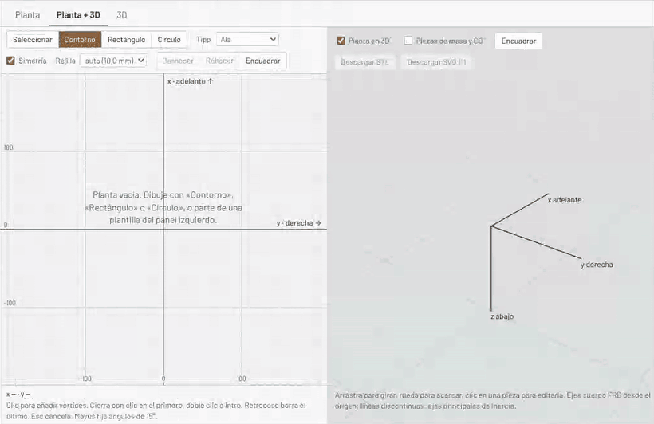

*Media ala dibujada con la herramienta Contorno: la simetría crea la otra mitad y el modelo 3D se construye mientras dibujas. Después se arrastra un vértice de la punta y el 3D le sigue.*

**Estado: PoC en curso.**
- Entrega 1: unidades SI, envoltorio de resultados y atmósfera ISA validada.
- Entrega 2: humedad y condiciones medidas, y modelo de masas (CG, inercia e incertidumbre).
- Entrega 3: la app web con el visor 3D básico (modelo de masas editable, CG, ejes, aire), con la física en un Web Worker.
- Entrega 4: editor de planta en un plano cartesiano (mm, morro arriba) que genera el modelo 3D al momento, con exportación STL y SVG 1:1; despliegue con Docker en local y en el VPS.
- Entrega 5: tour guiado dentro de la app y esta guía ilustrada.

## Índice

- [Empezar](#empezar)
- [Tour guiado](#tour-guiado)
- [La pantalla de un vistazo](#la-pantalla-de-un-vistazo)
- [1. Barra superior](#1-barra-superior)
- [2. Panel izquierdo: elementos, plantillas y proyecto](#2-panel-izquierdo-elementos-plantillas-y-proyecto)
- [3. Las tres vistas](#3-las-tres-vistas)
- [4. El editor de planta](#4-el-editor-de-planta)
- [5. Panel de propiedades](#5-panel-de-propiedades)
- [6. Del plano al modelo 3D](#6-del-plano-al-modelo-3d)
- [7. Resultados](#7-resultados)
- [8. Modelo de masas](#8-modelo-de-masas)
- [9. Archivos para el taller](#9-archivos-para-el-taller)
- [10. Tema oscuro y móvil](#10-tema-oscuro-y-móvil)
- [Atajos de teclado y ratón](#atajos-de-teclado-y-ratón)
- [Despliegue](#despliegue)
- [Para desarrollar](#para-desarrollar)
- [Lo que todavía no hace](#lo-que-todavía-no-hace)

---

## Empezar

### Requisitos

- Node ≥ 22.18 (ejecuta TypeScript directamente en `pnpm isa`) y pnpm 10.
- En Windows (PowerShell):

  ```powershell
  winget install OpenJS.NodeJS.LTS   # si no tienes Node; abre después una ventana nueva
  npm install -g pnpm@10
  # Si PowerShell dice que la ejecución de scripts está deshabilitada:
  Set-ExecutionPolicy -Scope CurrentUser RemoteSigned
  ```

### Abrir la app

```powershell
cd C:\Users\<tú>\Desktop\aeroforja
pnpm install
pnpm dev          # http://localhost:5173, se recarga sola al cambiar el código
```

O, igual que en el VPS, con Docker Desktop: `pnpm docker:local` y abre http://localhost:8080.

La primera vez se abre un **tour guiado** que recorre toda la pantalla. La app arranca con un quad X de 5" de ejemplo para que tengas algo que mirar y editar desde el primer momento.

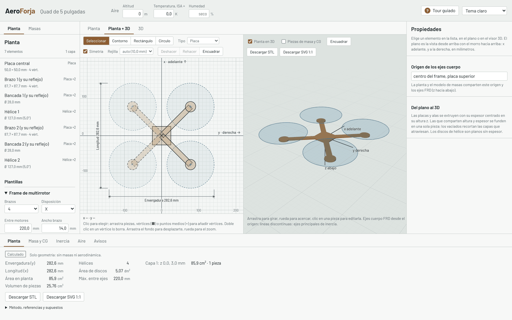

---

## Tour guiado

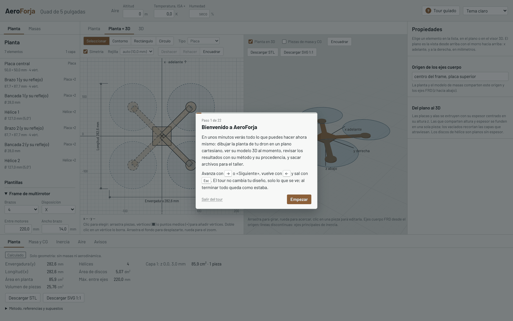

El tour se abre solo la primera vez que entras y, después, con el botón **Tour guiado** de la barra superior. Son 22 pasos: oscurece la pantalla, ilumina una zona y la explica en una tarjeta al lado. Cuando hace falta cambia de vista o selecciona algo para enseñártelo, y al terminar deja la vista, el panel y la selección como estaban. No modifica tu diseño.

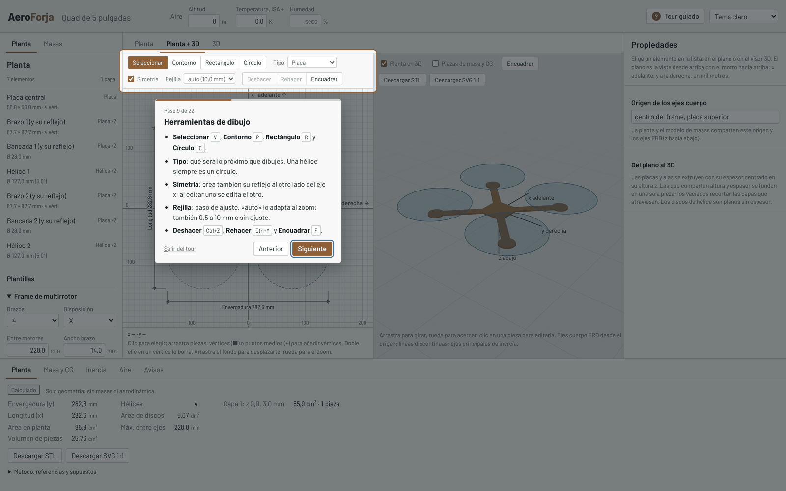

| Tecla | En el tour |
|---|---|
| <kbd>→</kbd> o «Siguiente» | paso siguiente |
| <kbd>←</kbd> o «Anterior» | paso anterior |
| <kbd>Esc</kbd> o «Salir del tour» | cerrar |

Recorre, en orden: proyecto, aire, tour y tema, pestañas Planta/Masas, lista de elementos, plantillas, vistas, herramientas, plano cartesiano, cómo dibujar, cómo editar, barra de estado, propiedades, visor 3D y sus opciones, resultados, archivos para el taller, modelo de masas, propiedades de una pieza, guardar y abrir, y un resumen de atajos.

---

## La pantalla de un vistazo

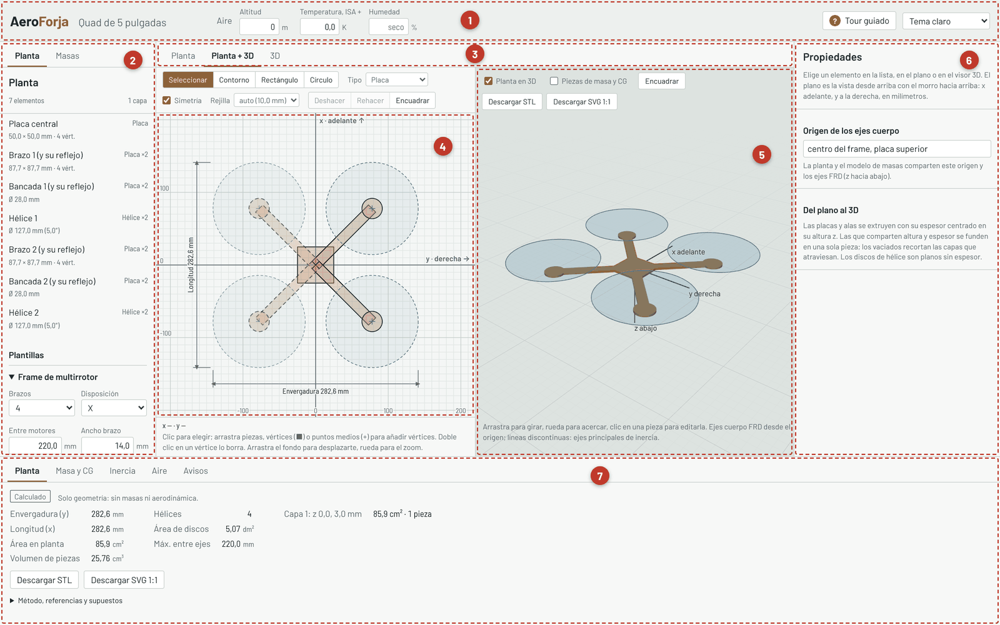

| # | Zona | Para qué |
|---|---|---|
| 1 | Barra superior | Nombre del proyecto, condiciones del aire, tour y tema |
| 2 | Panel izquierdo | Pestañas **Planta** y **Masas**: lista de lo que hay, plantillas y archivos del proyecto |
| 3 | Vistas | **Planta**, **Planta + 3D** o **3D** |
| 4 | Editor de planta | El plano cartesiano donde dibujas el dron visto desde arriba |
| 5 | Visor 3D | El modelo que sale del dibujo, más las piezas de masa y el CG si los activas |
| 6 | Propiedades | Todo lo editable de lo que tengas seleccionado |
| 7 | Resultados | Planta, Masa y CG, Inercia, Aire y Avisos, cada uno con su método y su procedencia |

Todo se guarda solo en el navegador mientras trabajas.

---

## 1. Barra superior

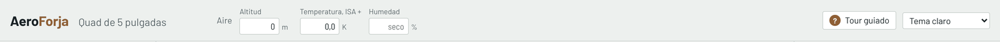

- **Nombre del proyecto**: haz clic y escribe. Se usa en los nombres de los archivos que descargas.
- **Aire**:
  - *Altitud* geométrica sobre el nivel del mar, en m.
  - *Temperatura, ISA +*: diferencia con la atmósfera estándar a esa altitud, en K (un día ISA + 10 K es 10 °C más cálido que el estándar).
  - *Humedad* relativa en %. Vacía significa aire seco.

  Los resultados salen en la pestaña [Aire](#7-resultados).
- **Tour guiado**: vuelve a abrir el tour.
- **Tema**: claro, oscuro o el de tu sistema. El plano y el 3D cambian de colores con él.

---

## 2. Panel izquierdo: elementos, plantillas y proyecto

### Elementos de la planta

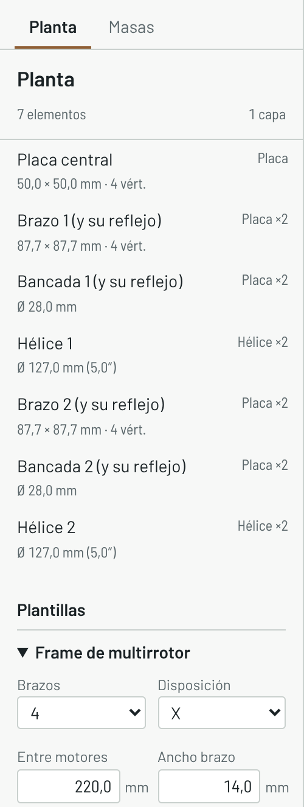

En la pestaña **Planta** cada línea es un elemento del dibujo:

- su **nombre**;
- su **tipo**: placa, ala, vaciado o hélice;
- **×2** si es simétrico (existe también su reflejo al otro lado del eje x);
- sus **medidas**: largo × ancho y número de vértices, o el diámetro en mm de un círculo (en una hélice también en pulgadas).

Un clic lo selecciona en el plano, en el 3D y en el panel de propiedades. Si un elemento tiene un error que impide construirlo, aparece un punto rojo delante de su nombre.

Arriba ves el total de elementos y en cuántas **capas** se reparten: cada capa es una plancha, es decir, piezas a la misma altura y con el mismo espesor.

<br clear="right">

### Plantillas paramétricas

Las plantillas generan un punto de partida editable a partir de unas pocas medidas. «**Sustituir planta**» borra lo que hay y pone la plantilla; «**Añadir**» la suma al dibujo. Las dos acciones se deshacen con <kbd>Ctrl</kbd>+<kbd>Z</kbd>.

#### Frame de multirrotor

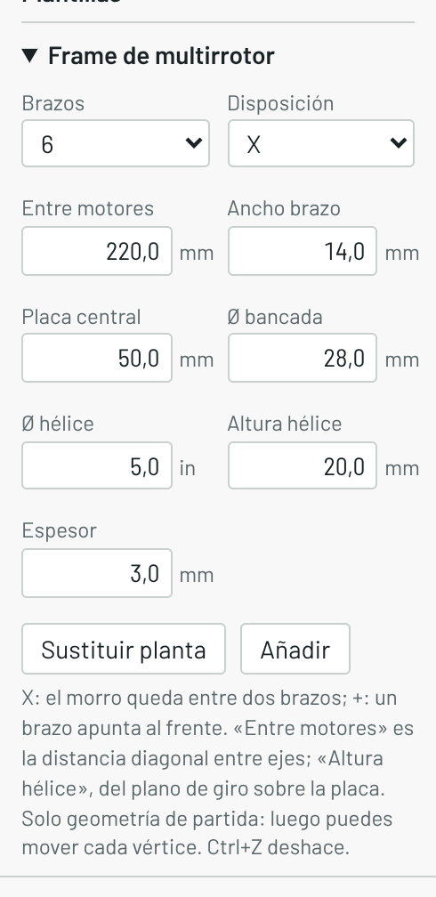

| Campo | Qué es |
|---|---|
| Brazos | 3, 4, 6 u 8 |
| Disposición | **X**: el morro queda entre dos brazos. **+**: un brazo apunta al frente |
| Entre motores | Distancia diagonal entre ejes de motores opuestos (en un quad, la medida «220 mm» de un 5") |
| Ancho brazo | Ancho de cada brazo |
| Placa central | Lado de la placa cuadrada del centro |
| Ø bancada | Diámetro del disco donde va el motor |
| Ø hélice | En pulgadas, como se venden |
| Altura hélice | Altura del plano de giro sobre la placa |
| Espesor | De la plancha |

Los brazos del lado derecho se crean con simetría: al editar un brazo se edita también su gemelo.

<br clear="left">

Un hexa de 450 mm entre motores con hélices de 8":

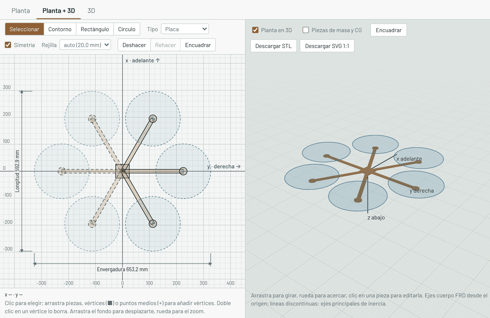

#### Ala por parámetros

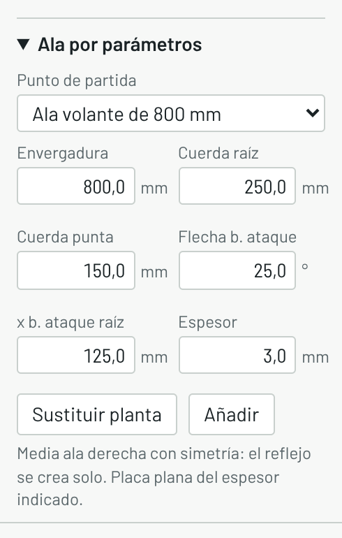

Punto de partida: **ala volante de 800 mm**, **delta de 800 mm** o **ala recta de 1000 mm**. Después ajustas:

- envergadura total;
- cuerda en la raíz y en la punta (0 en la punta da una delta);
- flecha del borde de ataque, en grados;
- posición x del borde de ataque en la raíz;
- espesor.

Crea la media ala derecha con simetría, así que el reflejo sale solo y queda una sola pieza.

<br clear="right">

Ala volante de 800 mm (S = 16,00 dm², alargamiento 4,00, cuerda media 200 mm):

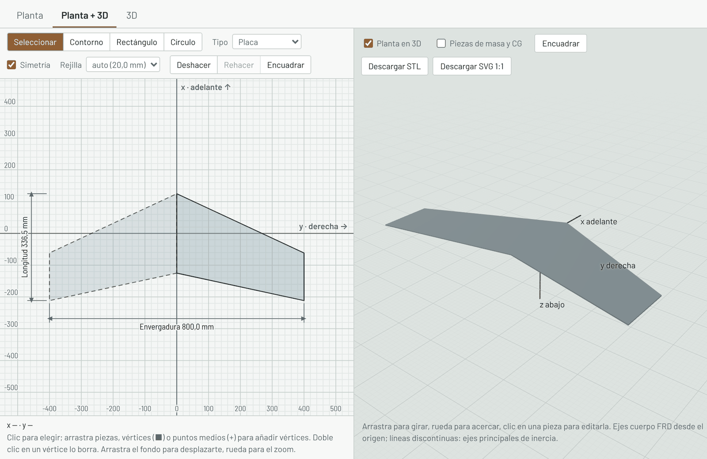

Delta de 800 mm:

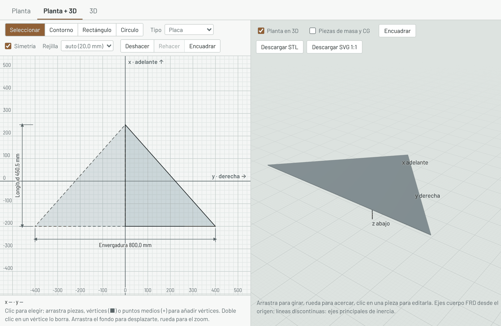

### Proyecto: guardar y abrir

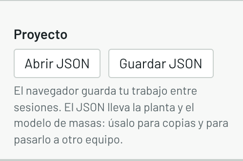

- **Guardar JSON** descarga el proyecto completo: nombre, modelo de masas y planta, en un archivo `nombre.aeroforja.json` con versión de formato (v2).
- **Abrir JSON** lo carga en cualquier equipo o navegador. Abre también los archivos v1 de la entrega 3, que solo tenían masas; esos entran con la planta vacía.
- Si un archivo está mal, la app dice qué falla (por ejemplo, «el radio tiene que ser mayor que cero») y no carga nada a medias.

---

## 3. Las tres vistas

Arriba del centro eliges **Planta**, **Planta + 3D** o **3D**. En «Planta + 3D» las dos vistas van sincronizadas: lo que dibujas aparece en 3D al instante y lo que seleccionas en una se selecciona en la otra.

| Solo planta | Solo 3D |
|---|---|
| 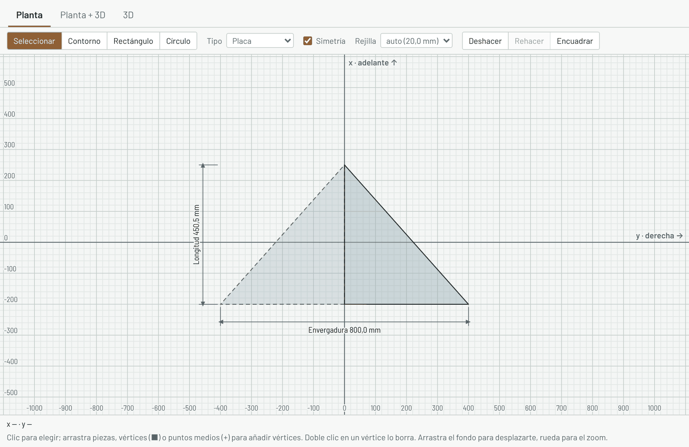 | 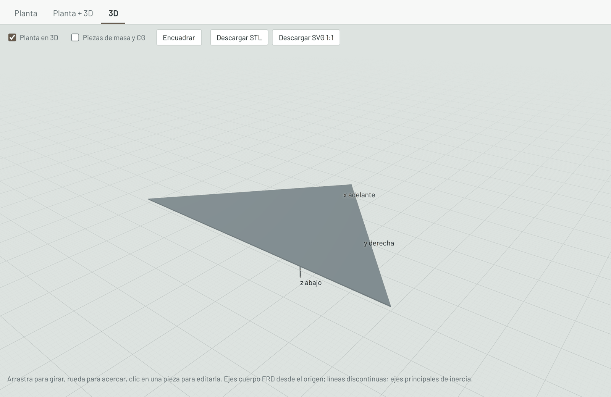 |

Al aplicar una plantilla o al abrir un archivo, las dos vistas se encuadran solas. El 3D se reencuadra también al pasar entre «Planta + 3D» y «3D», y cuando el dibujo crece o encoge mucho (por ejemplo, el primer contorno sobre un plano vacío). Los cambios pequeños no te mueven la cámara; para encuadrar a mano, «Encuadrar» en cada vista.

---

## 4. El editor de planta

### El plano cartesiano

El dron se ve **desde arriba con el morro hacia arriba**, en milímetros:

- **x adelante**, en vertical hacia arriba;
- **y a la derecha**, en horizontal.

Son los ejes cuerpo FRD vistos desde arriba, sin reflejar. El **origen (0, 0)** es el punto de referencia del aparato, el mismo que usa el modelo de masas, así que las dos cosas encajan.

- Las reglas de los bordes marcan los mm de la rejilla mayor.
- Las cotas de **Envergadura** (debajo) y **Longitud** (a la izquierda) se recalculan solas.
- Las líneas discontinuas son reflejos de elementos simétricos.
- La **rueda** hace zoom hacia el cursor; **arrastrar el fondo** (o usar el botón central o el derecho) desplaza la vista; **Encuadrar** (<kbd>F</kbd>) centra todo.

### Barra de herramientas


| Control | Qué hace |
|---|---|
| **Seleccionar** <kbd>V</kbd> | Elegir, mover y editar |
| **Contorno** <kbd>P</kbd> | Polígono por vértices |
| **Rectángulo** <kbd>R</kbd> | De esquina a esquina |
| **Círculo** <kbd>C</kbd> | De centro a radio |
| **Tipo** | Qué será lo siguiente que dibujes (ver la tabla de abajo) |
| **Simetría** | Crea también el reflejo al otro lado del eje x |
| **Rejilla** | Paso del ajuste: «auto» según el zoom, 0,5 / 1 / 2 / 5 / 10 mm, o sin ajuste |
| **Deshacer / Rehacer** | <kbd>Ctrl</kbd>+<kbd>Z</kbd> / <kbd>Ctrl</kbd>+<kbd>Y</kbd> (hasta 200 pasos) |
| **Encuadrar** <kbd>F</kbd> | Encaja todo el dibujo en el plano |

### Tipos de elemento

| Tipo | En el plano | En 3D | Para qué |
|---|---|---|---|
| **Placa** | Relleno marrón DM | Extrusión de su espesor | Frames, bancadas, placas, fuselajes de placa |
| **Ala** | Relleno gris azulado | Extrusión (placa plana) | Superficies sustentadoras. Cuentan para superficie alar, alargamiento y cuerda media, y son lo que leerá el VLM |
| **Vaciado** | Rayado, borde discontinuo | Agujero | Aligerados, ranuras, pasos de cables. Recorta las placas y alas que atraviesa a su altura |
| **Hélice (disco)** | Círculo azul discontinuo con cruz en el eje | Disco translúcido sin espesor | Comprobar holguras entre hélices y con la estructura |

### Dibujar un contorno

| Dibujando | Cerrando |
|---|---|
| 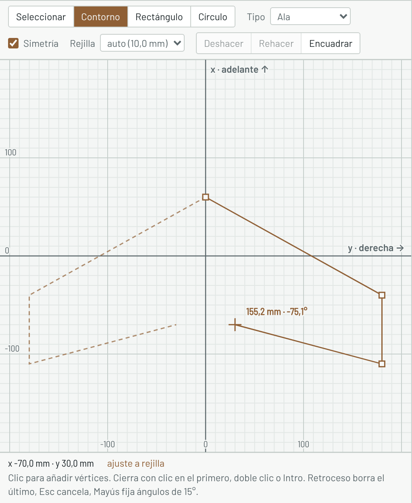 | 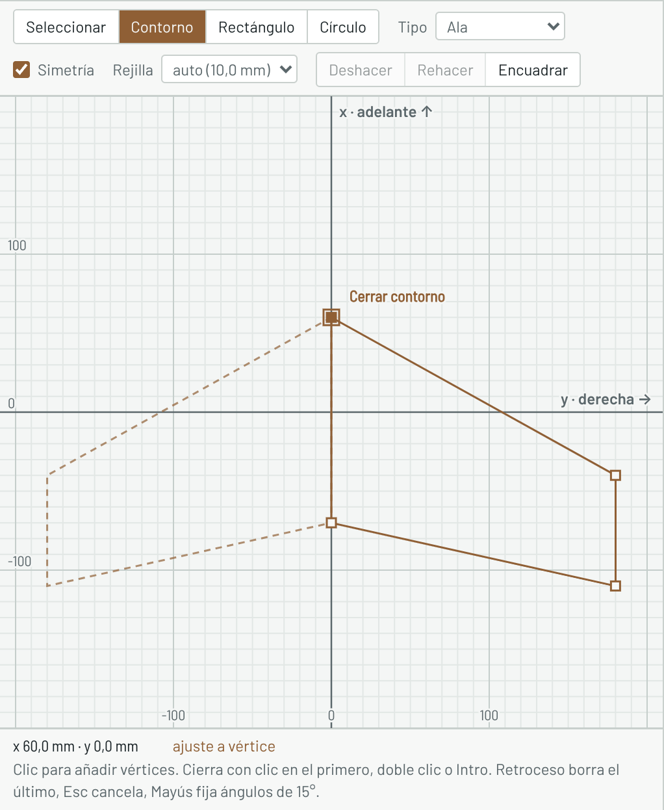 |

1. Elige **Contorno** <kbd>P</kbd> y el **Tipo**.
2. Haz un clic por vértice. Junto al cursor ves la **longitud y el ángulo** del tramo (0° hacia delante, 90° hacia la derecha). Con Simetría activada ves también el reflejo discontinuo.
3. Cierra con clic en el **primer vértice** («Cerrar contorno»), **doble clic** o <kbd>Intro</kbd>.
4. <kbd>Retroceso</kbd> quita el último vértice; <kbd>Esc</kbd> cancela; <kbd>Mayús</kbd> fija el tramo a múltiplos de 15°.

Para un ala o un fuselaje simétrico dibuja solo la **mitad derecha** empezando y terminando sobre el eje x: el reflejo cierra la otra mitad y las dos se funden en una pieza.

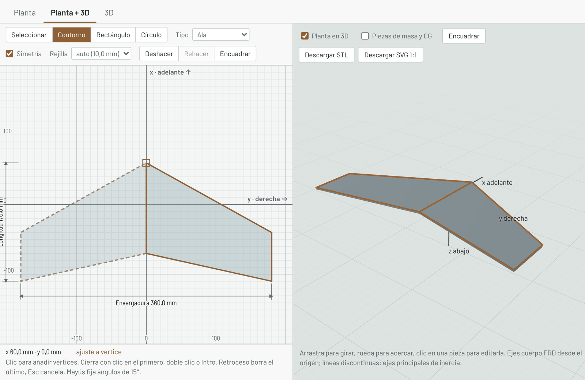

### Rectángulos y círculos

| Rectángulo desde el eje, con simetría | Círculo de vaciado |
|---|---|
| 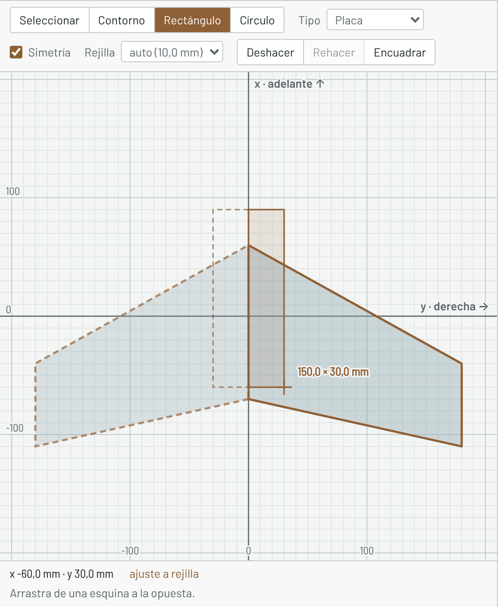 | 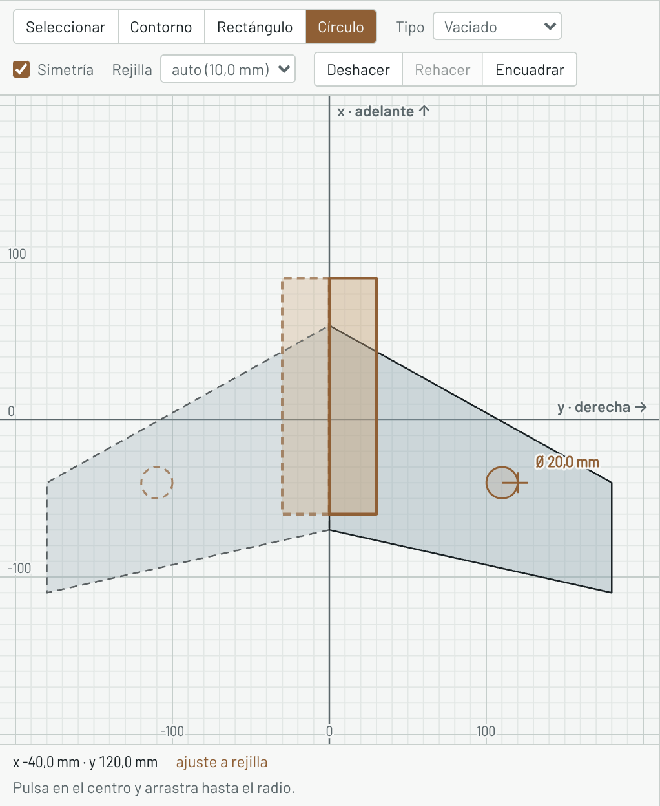 |

- **Rectángulo**: pulsa en una esquina y suelta en la opuesta. Mientras arrastras ves «largo × ancho». Si empiezas en el eje con Simetría activada, sale el rectángulo completo centrado.
- **Círculo**: pulsa en el centro y arrastra hasta el radio. Mientras arrastras ves el diámetro.

Las placas y alas que se tocan a la misma altura y con el mismo espesor se funden; los vaciados las agujerean:

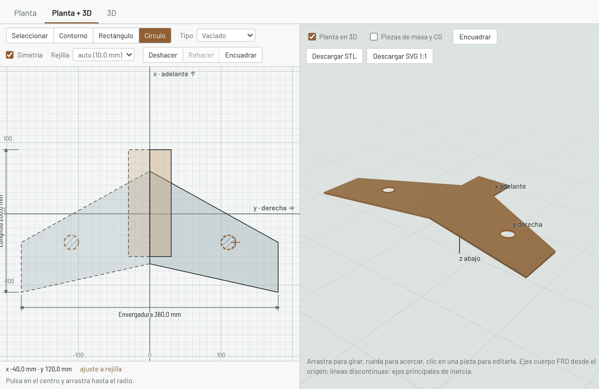

### Ajustes del cursor

| Marca | Ajuste |
|---|---|
| Cuadrado | Sobre un vértice existente o un centro de círculo, también de los reflejos |
| Rombo | Sobre el eje de simetría (y = 0) |
| Cruz | A la rejilla, con el paso elegido |

Con <kbd>Mayús</kbd> al dibujar un contorno manda el ángulo de 15°.

### Seleccionar y editar

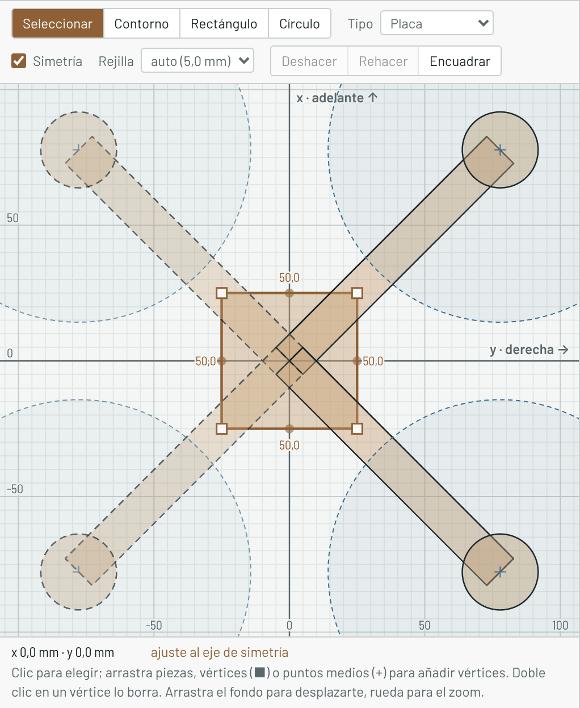

Con **Seleccionar** <kbd>V</kbd>:

- **Clic** en un elemento lo selecciona; clic en el fondo deselecciona.
- **Arrastra el elemento** para moverlo. Respeta el paso de la rejilla, y si arrastras el reflejo se mueve el original de forma simétrica.
- **Arrastra un cuadrado** para mover un vértice. Se engancha a otros vértices y al eje.
- **Arrastra un punto «+»** del medio de un lado para **añadir un vértice** ahí.
- **Doble clic en un vértice**, o elegirlo y pulsar <kbd>Supr</kbd>, lo quita (un contorno necesita al menos 3).
- En un círculo: el cuadrado del centro lo mueve y el punto del borde cambia el radio.
- Cada lado muestra su longitud en mm.
- Teclado: **flechas** para mover (<kbd>Mayús</kbd> ×10), <kbd>Supr</kbd> para borrar, <kbd>Ctrl</kbd>+<kbd>D</kbd> para duplicar.

Cada arrastre es un solo paso de deshacer.

<br clear="right">

Tirando del punto medio del lado delantero de la placa central sale un morro en punta:

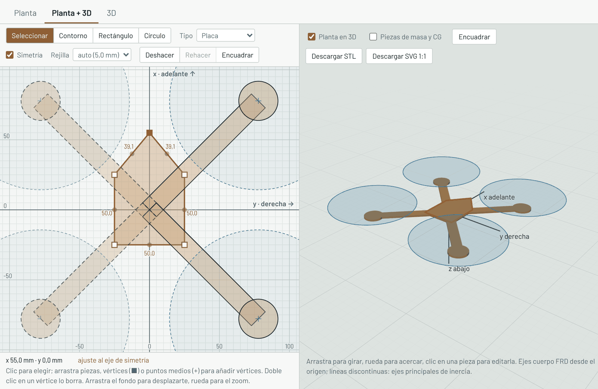

### Barra de estado

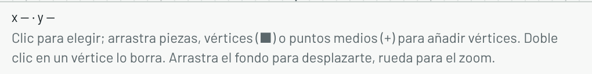

Debajo del plano: **coordenadas x / y del cursor** en mm, ya ajustadas, qué **ajuste** se está aplicando y la **ayuda** de la herramienta activa.

### Errores y avisos del dibujo

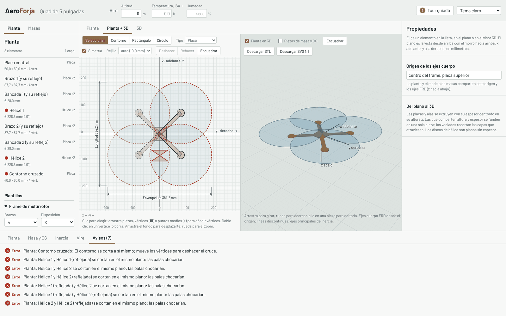

La app comprueba el dibujo en cada cambio y lo marca en rojo en el plano, en la lista de elementos y en **Avisos**.

**Errores**: el elemento no se construye en 3D.
- Un contorno que **se corta a sí mismo**.
- Un contorno sin superficie (menos de 1 mm²).
- Radio o espesor que no son mayores que cero.
- **Dos hélices que se cortan en el mismo plano**: las palas chocarían. En la captura, hélices de 9" en un frame de 220 mm.
- Un **disco de hélice que atraviesa una placa**: la hélice golpearía la estructura.

**Avisos**: se construye, pero conviene revisarlo.
- Dos hélices que se solapan en planta a distinta altura. El disco no tiene espesor y la interferencia entre hélices no está modelada.
- Un vaciado que no atraviesa nada a su altura.

---

## 5. Panel de propiedades

| Contorno seleccionado | Hélice seleccionada |
|---|---|
| 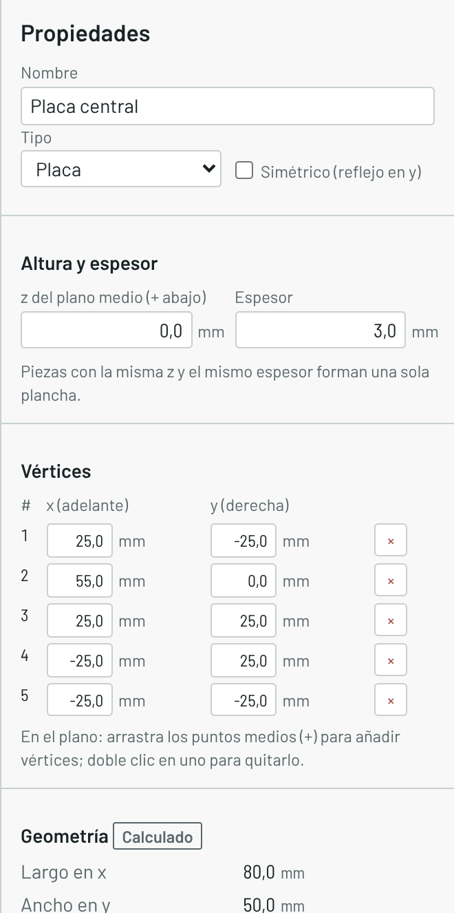 | 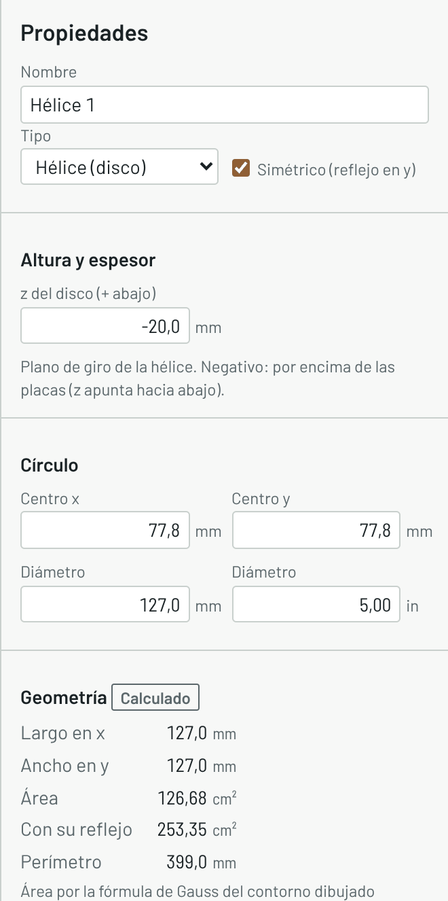 |

- **Nombre**, **Tipo** y **Simétrico (reflejo en y)**.
- **z del plano medio**, positiva hacia abajo (ejes FRD), y **espesor**, repartido por igual arriba y abajo de z. Las piezas con la **misma z y el mismo espesor** forman una sola plancha. En una hélice, z es su plano de giro: −20 mm significa 20 mm **por encima** de la placa.
- **Vértices**: tabla de x / y en mm que se edita a mano, con un botón × para quitar cada uno.
- **Círculo**: centro x / y y diámetro (en una hélice también en pulgadas).
- **Geometría** (CALCULADO): largo, ancho, área (fórmula de Gauss; en círculos, π r²), área con el reflejo, perímetro y volumen.
- **Duplicar** (desplazado 10 mm) y **Eliminar**.

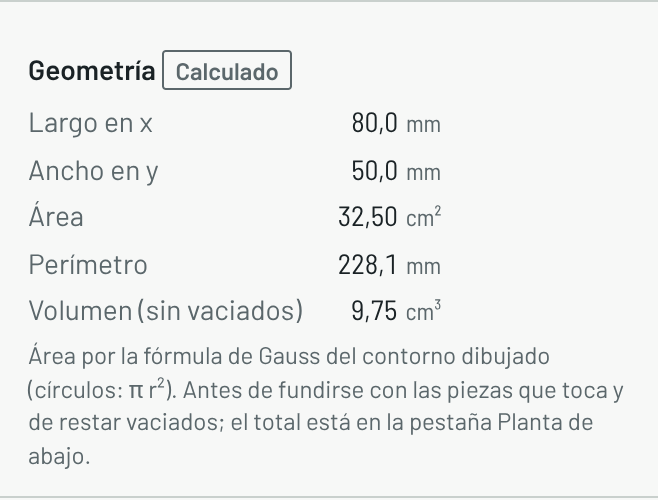

Sin nada seleccionado, el panel muestra el **origen de los ejes cuerpo** (texto que describe tu punto de referencia, compartido con el modelo de masas) y un resumen de cómo se pasa del plano al 3D.

---

## 6. Del plano al modelo 3D

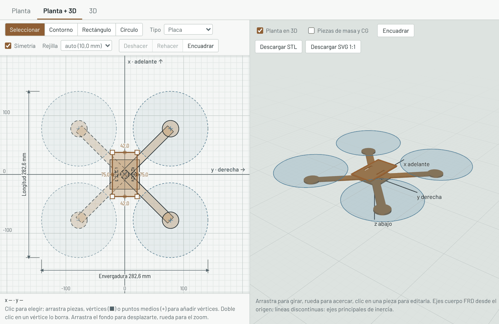

Cómo se construye el modelo:

1. Las **placas y alas** se agrupan en **planchas**: misma z y mismo espesor (al micrómetro).
2. En cada plancha se **unen** todos los contornos y sus reflejos, y se **restan** los vaciados cuya z cae dentro de su espesor. Son operaciones booleanas de polígonos con el algoritmo de Martínez, Rueda y Feito (2009).
3. Cada pieza resultante se **extruye** con su espesor.
4. Los círculos se convierten en polígonos de 24 a 1024 lados, con un error de cuerda de 0,01 mm como máximo.
5. Las **hélices** son discos translúcidos en su plano de giro.

En la captura: placa inferior de 3 mm con aligerados (capa a z = 0) y placa superior de 2 mm a 12 mm por encima con dos ranuras para la cinta de la batería (capa a z = −12 mm). Son dos capas y dos piezas.

### El visor 3D

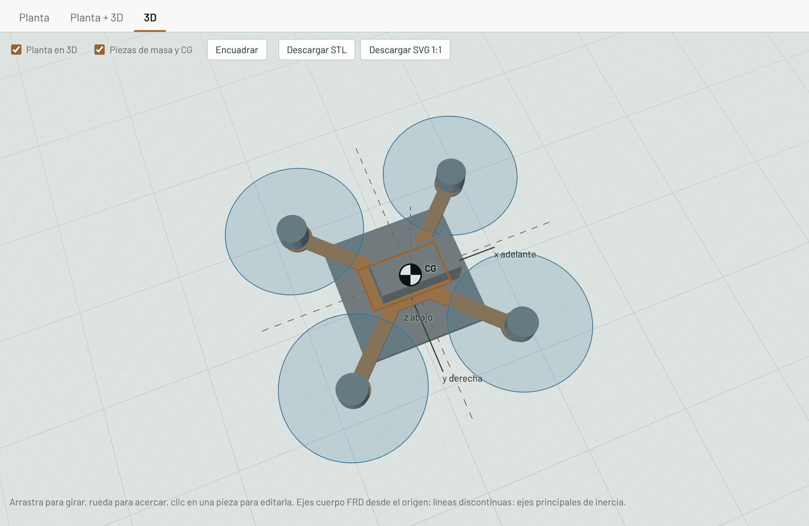

| Acción | Ratón |
|---|---|
| Girar | Arrastrar con el botón izquierdo |
| Acercar / alejar | Rueda |
| Desplazar | Arrastrar con el botón derecho |
| Seleccionar | Clic en una pieza: se selecciona también en el plano |
| Deseleccionar | Clic en el fondo |

Opciones de arriba:
- **Planta en 3D**: el modelo del dibujo.
- **Piezas de masa y CG**: los bloques del modelo de masas, el símbolo del **centro de gravedad** y los **ejes principales de inercia** (discontinuos).
- **Encuadrar**: centra la cámara en todo lo visible.
- **Descargar STL** y **Descargar SVG 1:1**: ver [archivos para el taller](#9-archivos-para-el-taller).

Los ejes cuerpo FRD salen del origen: x adelante, y derecha, z abajo.

Un clic en una pieza del 3D la selecciona en el plano y abre sus propiedades; el contorno elegido se resalta en el 3D:

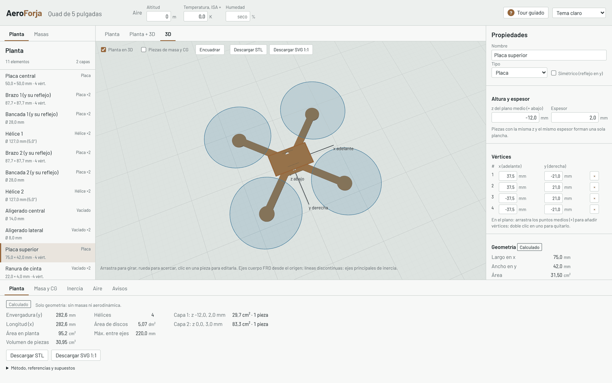

El 3D solo se redibuja cuando algo cambia, así que la app no gasta GPU ni batería mientras no la tocas.

---

## 7. Resultados

Cada resultado lleva:

| Marca | Significado |
|---|---|
| ✓ **Validado** (verde) | Dentro del rango en el que el método está validado contra casos publicados |
| ! **Fuera de lo validado** (ámbar) | Aplicable, pero fuera de lo validado |
| ✕ **Fuera de rango** (rojo) | El método no vale ahí; la app no extrapola en silencio |
| **Medido / Calculado / Estimado** | Procedencia: pesado o medido por ti, calculado por la app, o de catálogo o a ojo |
| **Método, referencias y supuestos** | Se despliega con un clic |

### Planta

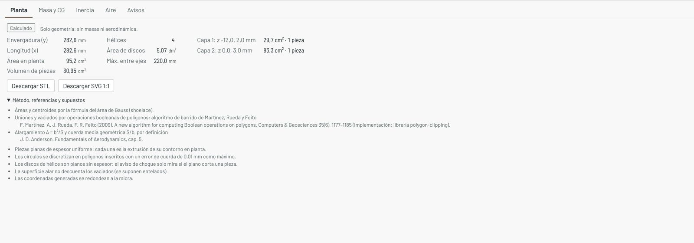

- Geometría del conjunto: envergadura, longitud, **área en planta** (todo fundido, sin vaciados) y **volumen de piezas** (área neta × espesor).
- Con alas: **superficie alar S**, envergadura alar, **alargamiento b²/S** y **cuerda media S/b**.
- Con hélices: número, **área de discos** y **distancia máxima entre ejes**.
- **Capas**: altura, espesor, área y número de piezas de cada plancha.
- Errores y avisos con un enlace que selecciona el elemento.
- Botones de STL y SVG.

### Masa y CG, Inercia y Aire

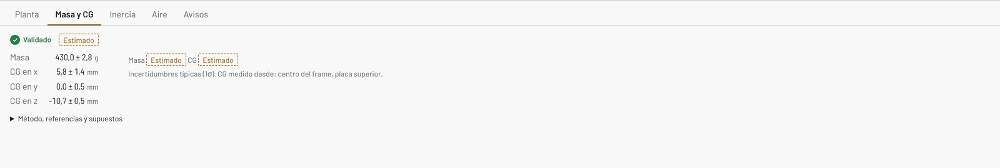

**Masa y CG**: masa total y posición del CG en mm con su incertidumbre (1σ, propagación GUM de primer orden), procedencia de cada cosa y punto desde el que se mide.

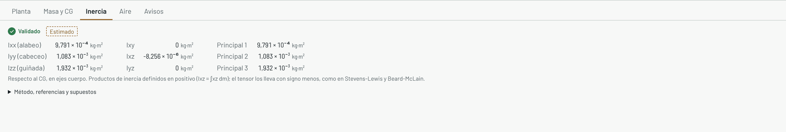

**Inercia**: tensor respecto al CG en ejes cuerpo (Ixx alabeo, Iyy cabeceo, Izz guiñada, productos de inercia en positivo) y momentos principales.

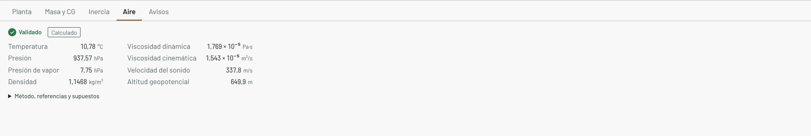

**Aire**: temperatura, presión, presión de vapor, densidad, viscosidades, velocidad del sonido y altitud geopotencial para las condiciones de la barra superior (en la captura, 650 m con 60 % de humedad).

### Avisos

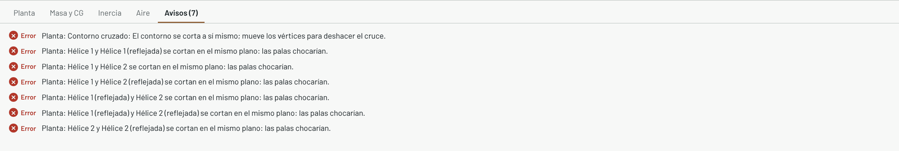

Junta todo lo que no está en verde: problemas de la planta y comprobaciones de validez de masas y aire. El número de la pestaña es el total.

---

## 8. Modelo de masas

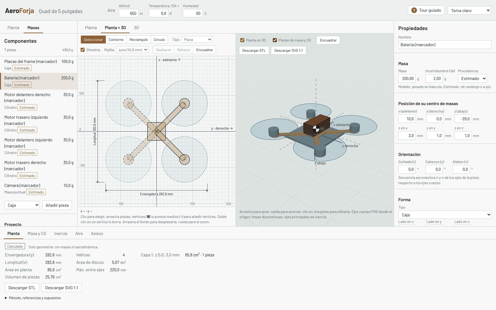

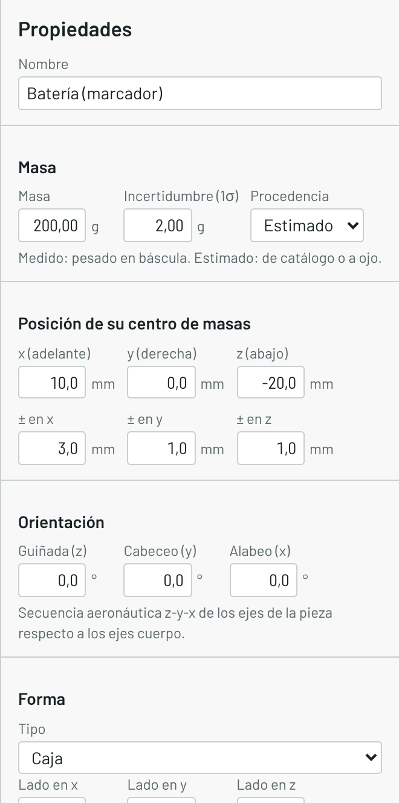

En la pestaña **Masas** del panel izquierdo está el modelo de masas: cada pieza con su masa en g, su forma y su procedencia. Abajo se añaden piezas por forma: **caja, cilindro, tubo, esfera o masa puntual**.

Propiedades de una pieza:

- **Masa** en g con su **incertidumbre (1σ)** y su **procedencia**: «Medido» si la has pesado.
- **Posición de su centro de masas** en mm (x adelante, y derecha, z abajo), con incertidumbre opcional por eje.
- **Orientación**: guiñada, cabeceo y alabeo (secuencia aeronáutica z-y-x).
- **Forma** y medidas, que dan su inercia propia (sólidos homogéneos). Un tensor de inercia medido se puede traer en el JSON del proyecto.
- **Duplicar** y **Eliminar pieza**.

Masa, CG e inercia del conjunto salen en [Resultados](#7-resultados). Para verlas junto a la planta, activa «Piezas de masa y CG» en el 3D.

<br clear="right">

> La planta todavía no aporta masa: es geometría. La masa de cada pieza dibujada (volumen × densidad medida de tu material) llega con el banco de materiales del módulo de fabricación.

---

## 9. Archivos para el taller

| Botón | Archivo | Detalles |
|---|---|---|
| **Descargar STL** | `nombre-planta.stl` | STL binario de todas las piezas, en **mm** y con **Z hacia arriba** (el FRD girado 180° en x), listo para el laminador. Los vaciados salen como agujeros; los discos de hélice no se exportan |
| **Descargar SVG 1:1** | `nombre-planta-1a1.svg` | Contorno de cada plancha a **escala real** en mm, con el morro hacia arriba, una etiqueta con espesor y altura, y una **regla de control de 50 mm** para comprobar la escala al imprimir o al importar en el láser |
| **Guardar JSON** | `nombre.aeroforja.json` | El proyecto completo (planta y masas) |

El SVG del quad de ejemplo, tal cual sale:

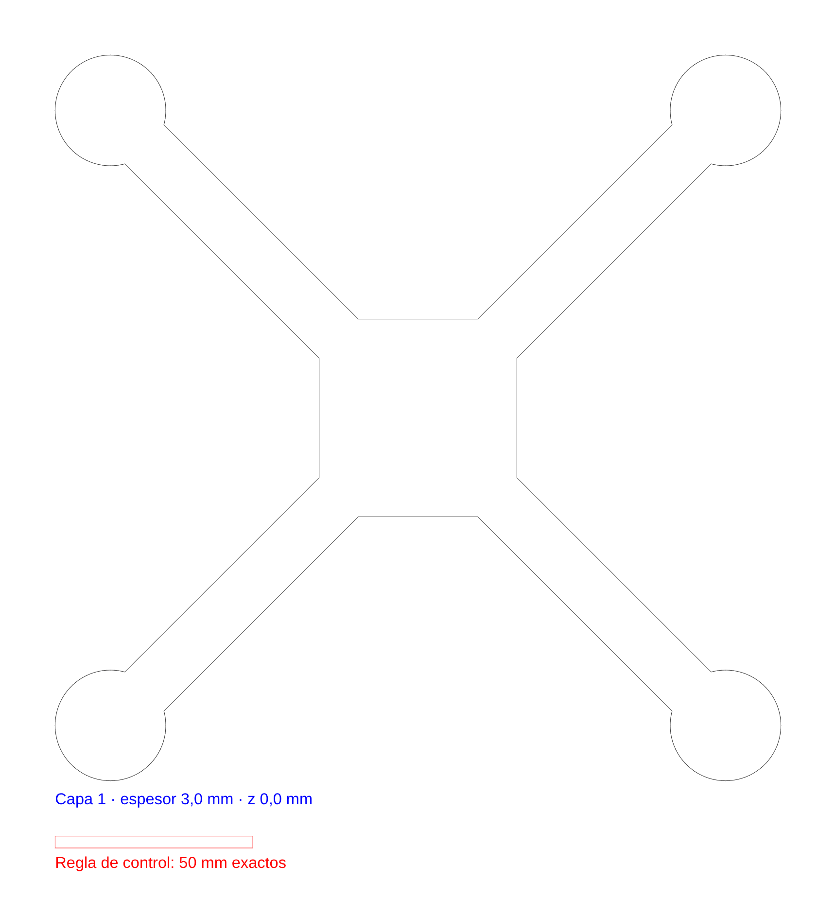

El SVG todavía **no compensa el kerf** (el ancho de corte del láser): eso necesita tu medida de kerf del módulo de fabricación.

---

## 10. Tema oscuro y móvil

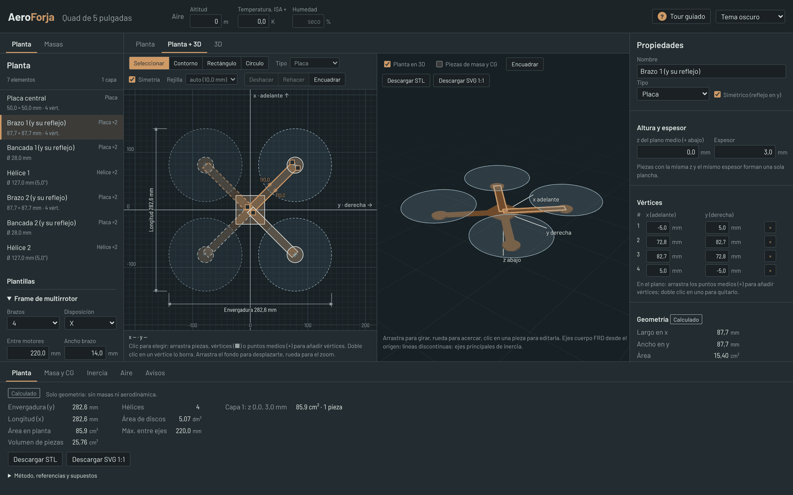

En pantallas estrechas los paneles se apilan: plano, 3D, panel izquierdo, propiedades y resultados. En móvil, la tarjeta del tour se pega a la parte inferior.

<p>
  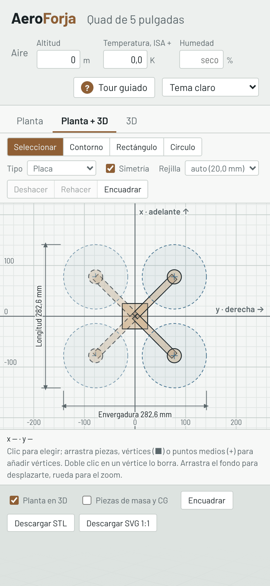
  &nbsp;
  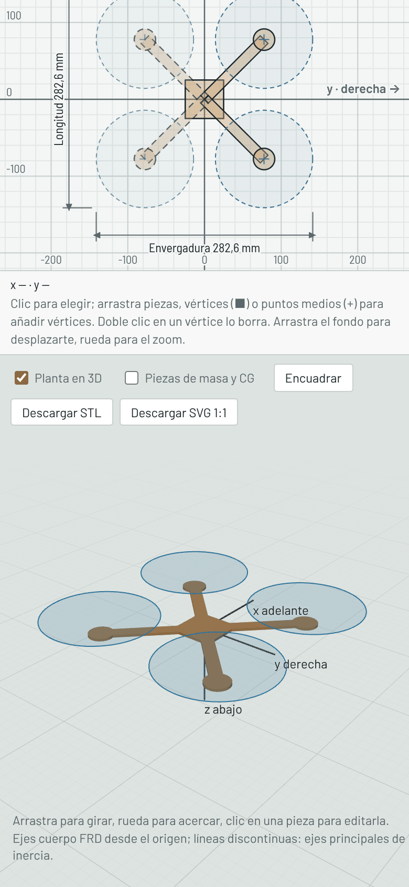
</p>

---

## Atajos de teclado y ratón

| Atajo | Acción |
|---|---|
| <kbd>V</kbd> <kbd>P</kbd> <kbd>R</kbd> <kbd>C</kbd> | Seleccionar, Contorno, Rectángulo, Círculo |
| <kbd>Ctrl</kbd>+<kbd>Z</kbd> | Deshacer |
| <kbd>Ctrl</kbd>+<kbd>Y</kbd> o <kbd>Ctrl</kbd>+<kbd>Mayús</kbd>+<kbd>Z</kbd> | Rehacer |
| <kbd>Ctrl</kbd>+<kbd>D</kbd> | Duplicar el elemento seleccionado |
| <kbd>Supr</kbd> / <kbd>Retroceso</kbd> | Borrar el elemento o el vértice elegido; al dibujar, quitar el último vértice |
| Flechas | Mover el elemento seleccionado un paso de rejilla (<kbd>Mayús</kbd>: ×10) |
| <kbd>F</kbd> | Encuadrar el plano |
| <kbd>Intro</kbd> | Cerrar el contorno |
| <kbd>Esc</kbd> | Cancelar el dibujo, deseleccionar, volver a Seleccionar o cerrar el tour |
| <kbd>Mayús</kbd> al dibujar | Ángulos de 15° |
| Doble clic | Cerrar el contorno / quitar un vértice |
| Rueda | Zoom (plano: hacia el cursor) |
| Arrastrar el fondo, botón central o derecho | Desplazar el plano |
| Arrastrar en 3D | Girar (botón derecho: desplazar) |

Los atajos del plano actúan con la pestaña **Planta** del panel izquierdo activa, y no mientras escribes en un campo o con el tour abierto.

---

## Despliegue

AeroForja es una web estática: todo el cálculo corre en tu navegador y el servidor solo entrega archivos. La imagen Docker se construye pasando antes `pnpm check` (tipos y tests de validación), así que un núcleo que falla sus casos publicados no se despliega.

- **Local**: `pnpm dev` para desarrollar, o `pnpm docker:local` → http://localhost:8080.
- **VPS** (detrás del `reverse_proxy` de docker-modular-infra): DNS `aeroforja.tenebrum.online` → IP del VPS y, en el VPS:

  ```bash
  sudo git clone https://github.com/lilpissbaby/aeroforja /opt/homelab/apps/aeroforja
  cd /opt/homelab/apps/aeroforja && sudo ./docker/vps/deploy.sh
  ```

  Para actualizar, el mismo script. Va con el basic auth de la infra hasta que se decida si es de uso personal o público.

Todos los detalles en [`docs/despliegue.md`](docs/despliegue.md).

---

## Para desarrollar

### Comandos

```bash
pnpm install
pnpm dev         # la app en http://localhost:5173 (se recarga sola al cambiar el código)
pnpm build       # versión de producción en packages/app/dist
pnpm preview     # sirve esa versión en http://localhost:4173
pnpm test        # tests unitarios + validación física (Vitest)
pnpm typecheck   # TypeScript estricto en todos los paquetes
pnpm check       # las dos cosas
pnpm isa 1500        # atmósfera a 1 500 m geométricos, con método, supuestos y semáforo
pnpm isa 1500 10 70  # lo mismo en un día ISA + 10 K con 70 % de humedad
pnpm air 1008 24 65  # aire medido: 1008 hPa de estación, 24 °C, 65 % de humedad
pnpm mass            # masa, CG e inercia del cuerpo sintético de ejemplo
pnpm mass mi-quad.json  # ...o de tu propio modelo (mismo formato que examples/mass-model.example.json)
pnpm docker:local    # la app en Docker en http://localhost:8080 (igual que en el VPS)
pnpm docs:capture    # rehace las capturas de este README (ver abajo)
```

### Regenerar las capturas

Las imágenes de `docs/img/` las hace `scripts/capture-docs.cjs`, que maneja la app de verdad en un Chromium sin ventana: carga ejemplos, dibuja, arrastra vértices, aplica plantillas y descarga el SVG.

```bash
npm i -g playwright && npx playwright install chromium   # una vez
pnpm build && pnpm preview          # en una terminal
pnpm docs:capture                   # en otra (NODE_PATH=$(npm root -g) si no encuentra Playwright)
pnpm docs:optimize                  # reduce las PNG (necesita Python con Pillow)
```

El GIF necesita además ffmpeg. Con `SCENES=drawing,editing pnpm docs:capture` se rehacen solo algunas escenas.

### Estructura

```
packages/
  physics/      núcleo puro: unidades SI, vectores FRD/NED, cuaterniones, Result<T>,
                atmósfera (ISA, humedad, condiciones medidas) y modelo de masas
                (sin UI, sin APIs de navegador ni de Node)
  validation/   casos de referencia publicados, con fuente, cadena de transcripción y tolerancia
  app/          interfaz web (Vite + React + three.js); la física corre en un Web Worker
    src/planform/   geometría de la planta: modelo, booleanas, plantillas, malla, STL/SVG
    src/ui/         paneles, editor de planta, visor 3D y tour guiado
examples/       scripts de consola y el modelo de ejemplo
scripts/        capturas de la documentación
docs/design/    mini-diseños aprobados, uno por módulo físico, y notas de diseño
docs/img/       capturas de este README
docs/decisiones.md  decisiones cerradas y abiertas
docs/despliegue.md  local y VPS
docker/         Dockerfile, nginx del contenedor, compose local y del VPS, conf para la infra
data/raw/       datos de terceros sin procesar (fuera de git)
```

Vendrán `data/` procesado (hélices UIUC, perfiles, motores, baterías), `solvers-wasm/` y `cfd-webgpu/` según la hoja de ruta.

### Reglas del núcleo

- Todo en SI. La conversión a mm, g, rpm o °C vive solo en la UI.
- Cada magnitud lleva su unidad en el tipo (`Meters`, `Kelvin`, `Pascals`…): el compilador impide mezclar una presión con una temperatura.
- Ningún resultado sale sin su envoltorio `Result<T>`: valor, procedencia (MEASURED, CALCULATED o ESTIMATED), métodos con referencia, supuestos y semáforo de validez (verde validado, ámbar aplicable sin validar, rojo fuera de rango).
- `physics` compila sin las librerías del navegador ni de Node: usar `document`, `fetch` o `process` es un error de compilación.
- Misma entrada, mismo resultado.
- Ningún módulo físico está terminado sin tests de validación contra casos publicados con tolerancia explícita.

Notas de diseño del editor de planta: [`docs/design/003-planta-2d-a-3d.md`](docs/design/003-planta-2d-a-3d.md).

---

## Lo que todavía no hace

- **Masa de las piezas dibujadas**: la planta es solo geometría. Volumen × densidad medida llega con el banco de materiales (módulo de fabricación) y su mini-diseño.
- **Aerodinámica**: no hay todavía VLM, perfiles ni BEMT. Las alas se dibujan y se miden, pero no se calculan fuerzas.
- **Perfil real del ala**: el 3D es una placa plana del espesor indicado (la técnica «placa plana» del módulo de fabricación). Costillas y perfiles, en la v1.
- **Vistas lateral y frontal**, cotas editables, restricciones y variantes: MVP.
- **Kerf, anidado por plancha y DXF**: módulo de fabricación.
- **Hélices**: el disco no tiene espesor y no hay modelo de interferencia entre rotores.
- **Datos**: se guardan en cada navegador y en los JSON que descargues; no se sincronizan entre equipos.

## Licencia

Sin licencia por ahora (todos los derechos reservados). Se decide antes de publicar nada; afecta a la integración de un solver derivado de XFOIL (GPL).
