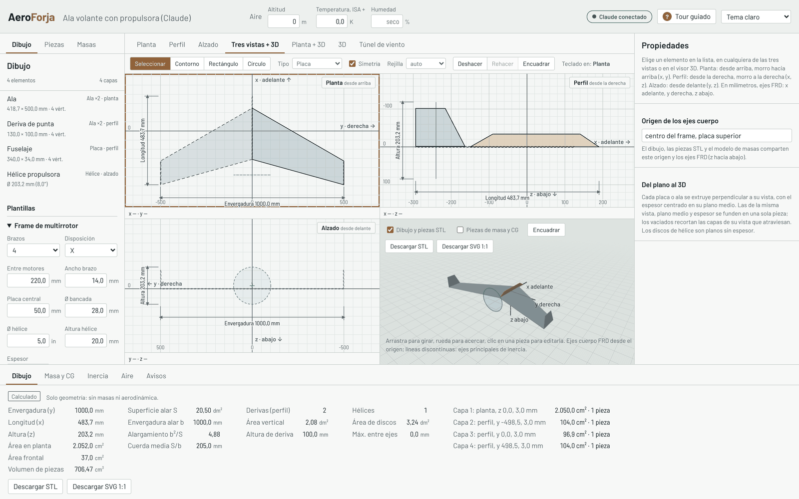
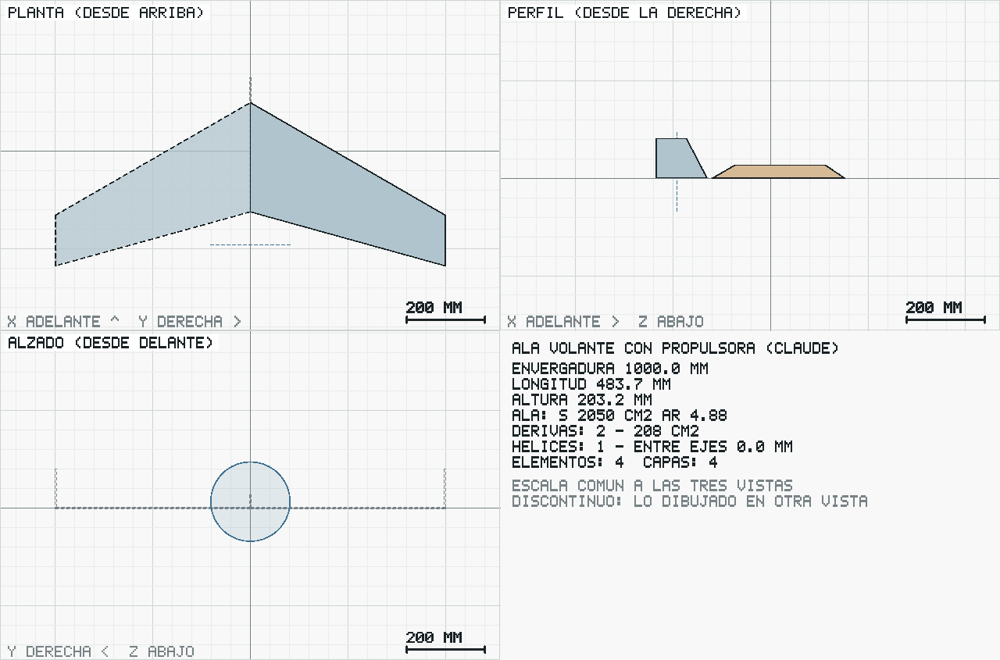

# Diseñar con Claude Desktop

AeroForja trae un servidor MCP (Model Context Protocol) para que Claude Desktop diseñe dentro de la app: le describes el dron o le mandas una foto o un boceto, y Claude lo dibuja en las tres vistas, lo mira renderizado, le pone el modelo de masas, lo ensaya en el túnel y te explica el resultado con su procedencia. Si tienes la app abierta en el mismo equipo, ves cada cambio al momento y puedes seguir editando a mano; Claude ve tus cambios.



## Instalar (una vez)

Requisitos: Node 22.18 o posterior (el mismo que pide el proyecto) y Claude Desktop.

```bash
git clone https://github.com/lilpissbaby/aeroforja.git
cd aeroforja
pnpm install
pnpm mcp:install
```

`pnpm mcp:install` añade la entrada `aeroforja` al archivo de configuración de Claude Desktop y deja copia del anterior (`.bak`); no toca los demás servidores:

| Sistema | Archivo |
|---|---|
| Windows | `%APPDATA%\Claude\claude_desktop_config.json` |
| macOS | `~/Library/Application Support/Claude/claude_desktop_config.json` |
| Linux | `~/.config/Claude/claude_desktop_config.json` |

Cierra Claude Desktop del todo (desde la bandeja del sistema o la barra de menús) y ábrelo otra vez. En el menú de herramientas o conectores aparece **aeroforja**. Con `pnpm mcp:install --print` ves la entrada sin escribir nada, por si prefieres pegarla a mano.

## Usarlo

Abre la app (`pnpm dev`, `pnpm docker:local` o tu despliegue) en el mismo equipo. En la barra superior aparece **Claude conectado** cuando el servidor está activo. Si Claude tenía otro diseño de una sesión anterior, la app pregunta con cuál seguir.

Ejemplos de lo que puedes pedir:

- «Dibuja un ala volante de 900 mm con 28° de flecha, derivas de punta de 9 cm y una hélice propulsora de 8 pulgadas detrás.»
- Con una foto o un boceto adjunto: «Quiero un dron como este; las medidas que sé son…»
- «Ponle una batería 3S de 1300 mAh que pesa 112 g (pesada) a 40 mm delante del origen y dime si es estable.»
- «Pásalo por el túnel a 15 m/s y dime el L/D y el margen estático.»

Claude trabaja con estas herramientas:

| Herramienta | Qué hace |
|---|---|
| `get_design` | Lee el diseño: elementos en mm, avisos, cotas, masas y piezas STL |
| `add_elements`, `update_element`, `remove_elements` | Dibuja y edita en planta (`top`), perfil (`side`) y alzado (`front`) |
| `apply_template` | Multirrotor o ala por parámetros |
| `set_mass_components` | Modelo de masas con procedencia (MEDIDO o ESTIMADO, nunca al revés) |
| `render_views` | PNG de las tres vistas a escala común, para comparar con tu imagen |
| `analyse` | Geometría, masa, CG e inercia con método y semáforo |
| `run_tunnel` | Túnel virtual: CL, CD, Cm, L/D, punto neutro y margen estático |
| `save_project`, `open_project` | Archivos `.aeroforja.json`, los mismos que abre la app |
| `app_status` | Si la app está conectada |

Lo que Claude ve al pedir `render_views`:



## Cómo funciona

```
Claude Desktop ──stdio (JSON-RPC, MCP)──► packages/mcp/src/server.ts ──► mismo núcleo físico y mismo modelo de proyecto que la app
                                                │
                                                └── http://127.0.0.1:47615 ◄──► la app en el navegador (SSE + POST)
```

- El servidor no tiene dependencias: Node ejecuta el TypeScript directamente. Usa el mismo código que la app para el dibujo, las booleanas, el túnel y los archivos, así que lo que calcula Claude es lo que ves.
- El diseño se guarda tras cada cambio en `~/.aeroforja/claude-desktop.aeroforja.json` (variable `AEROFORJA_PROJECT` para cambiarlo).
- El puente escucha **solo en 127.0.0.1** (puerto 47615, variable `AEROFORJA_BRIDGE_PORT`). Nada sale de tu equipo. La app lo intenta cada pocos segundos y, si no está, no pasa nada.
- Las mallas STL no viajan al servidor: se quedan en el navegador. Por eso la masa de las piezas STL la cuenta la app, no `analyse`.
- Si la app está servida desde tu VPS por HTTPS, Chrome puede pedir permiso para acceder a la red local la primera vez: acéptalo para que se conecte al puente.

## Límites honestos

- Claude no ve la pantalla de la app: ve el PNG de `render_views` y los números. Para ver tus cambios a mano, pídele que lea el diseño.
- Interpretar una foto es aproximado: Claude estima proporciones y te pide las medidas que falten. Las masas y los datos de motor, hélice o batería no los inventa: te los pregunta o los marca como ESTIMADOS.
- El túnel tiene los mismos límites que en la app (flujo potencial, sin pérdida ni hélices); Claude tiene que darte el semáforo con cada número.
